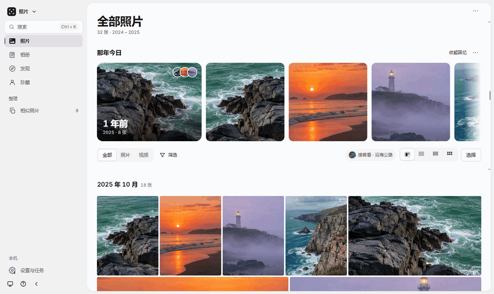
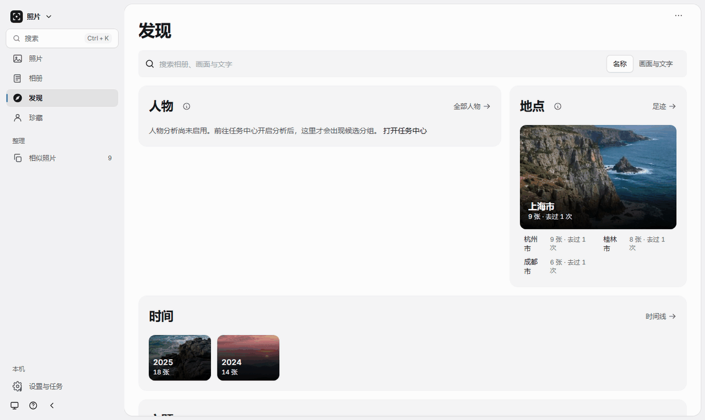
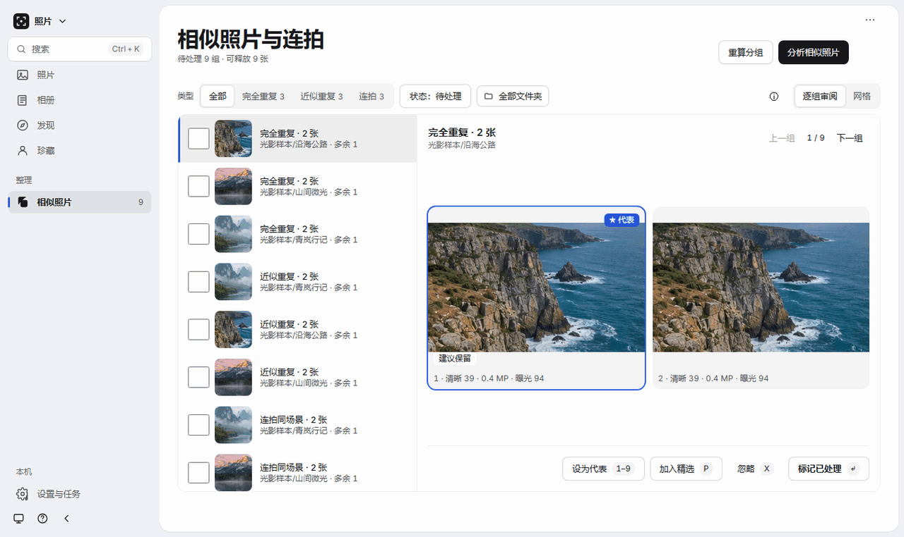
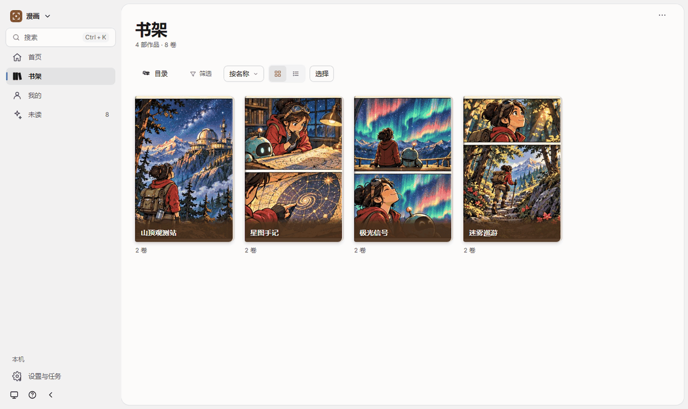
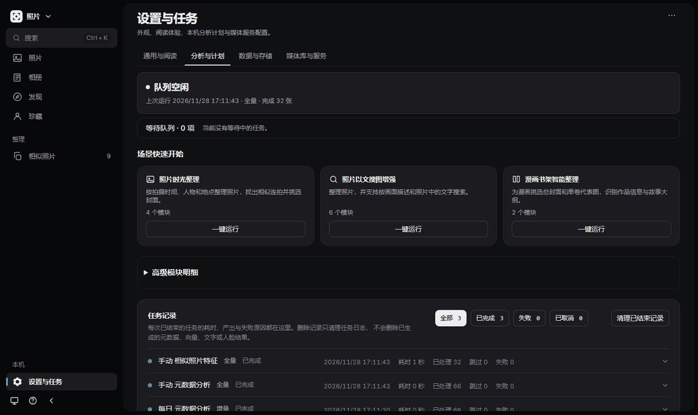

# Local Gallery · 本地画廊

在浏览器里翻看本机照片和视频、寻找旧照、整理连拍，或从上次读到的一页接着看漫画。Local Gallery 直接读取你选定的目录，在本机保存浏览记录、精选、收藏和分析结果。原始媒体始终只读。

[下载发布包](https://github.com/ttf248/local-gallery/releases) · [开始使用](#开始使用) · [从源码运行](#从源码运行) · [项目文档](#项目文档)

## 实机演示

演示录自当前源码运行的独立图库。风景照片与漫画页为 AI 生成的虚构素材，演示日期和地点为样例数据。

### 照片 · 从时间线到大图

按年、月或媒体类型浏览全库时间线。也可在「相册」沿原有文件夹层级打开照片墙。进入大图后可翻看相邻照片、查看拍摄信息或加入精选。



### 发现 · 从地点找回照片

按年份、人物、地点和智能相册主题探索图库。「足迹」从 EXIF 坐标生成聚合地图和行程，展开一段行程即可查看当时的照片。安装并运行对应分析后，还可以用中文描述、相似图片或照片里的文字检索。



### 整理 · 逐组挑选代表照片

本机分析会将完全重复、近似副本和连拍分组。逐组对照后，可更换代表照片、标记已处理、忽略或加入精选。「珍藏」汇集精选照片、收藏的相册等资源与最近浏览记录。



### 漫画 · 从书架接着读

漫画目录进入独立书架，按作品和话序组织。阅读器支持单页、连续、双页和从右向左翻页，并保存阅读进度。下次可从首页「继续阅读」回到上次的位置。



### 设置与任务 · 管理本机图库

在「分析与计划」运行照片元数据、文字识别、语义向量、人脸、相似照片等分析，也可以安排每日增量任务。「数据与存储」提供派生缓存清理和本机状态备份恢复，「媒体库与服务」用于管理目录、扫描与访问方式。



## 开始使用

从 [GitHub 发布页](https://github.com/ttf248/local-gallery/releases) 下载 v2 对应系统与架构的包。v1.x 用户把 v2 解压到新目录后，重新添加原来的媒体目录。

| 平台              | 启动                                                                                                                                                                                  |
| ----------------- | ------------------------------------------------------------------------------------------------------------------------------------------------------------------------------------- |
| Windows 10/11 x64 | 完整解压 `local-gallery-v2.x.y-windows-amd64-portable.zip` 到有写权限的目录，双击 `start.bat`。                                                                                       |
| macOS / Linux     | 解压对应的 x64 或 Arm64 包，在包目录运行 `cp config.example.yaml config.yaml`，然后运行 `./local-gallery --config ./config.yaml`。可先将配置的 `mediaRoots` 改为 `[]`，启动后再添加。 |

1. 用浏览器打开 <http://127.0.0.1:8080>。
2. 在「设置与任务 → 媒体库与服务」添加目录，每个目录选择「照片」或「漫画」。应用会扫描其子目录。
3. 从侧栏切换工作台开始浏览。按 `Ctrl+C` 可停止启动终端里的服务。

### 启用本机分析与视频增强

- **Windows x64 便携包**内置 Python、FFmpeg、Chinese-CLIP、RapidOCR、YuNet 和 SFace。核心分析可离线运行。支持 DirectML 的 GPU 优先参与推理，未检测到可用 GPU 时使用 CPU。可用包内的 `download-extra-models.bat` 添加 Buffalo_m 和相册封面审美模型。模型来源见[便携包第三方组件说明](./scripts/windows-portable/第三方组件.md)。
- **macOS / Linux 基础包**可直接浏览照片、漫画及浏览器原生支持的视频。可安装 FFmpeg / ffprobe 或配置 `ffmpegPath` 来生成视频封面、处理转码和转换部分图片格式。安装本机 AI 见[分析环境](#分析环境)。
- 在「设置与任务 → 分析与计划」启动所需模块。人物分析需要先显式启用，人脸分组提供待确认的相似候选；足迹在本机处理带 GPS 的照片，使用离线地图。

### 配置与本地数据

运行配置保存在 YAML 中，通过 `--config` 指定。媒体根目录含 `path` 和 `kind`，类型为 `photo` 或 `comic`。相对路径以进程工作目录为准。应用默认仅接受本机回环访问；在可信局域网启用 `accessMode: lan` 时须配置访问令牌。完整字段和示例见[配置样例](./backend/config.example.yaml)与 [API 文档](./docs/API.md#健康与配置)。

默认数据目录是进程工作目录下的 `.local-gallery/`。其中 `state/` 保存本机状态，`derived/` 保存可重建的缩略图和分析产物，可在「数据与存储」查看及管理。应用可在本机监听媒体目录变化，增量更新图库。项目面向单用户，媒体以目录组织，ZIP/RAR 压缩包需先解压。

## 从源码运行

安装 Git、Go 1.24+ 和 Node.js 20+（含 npm）。Windows 在仓库根目录运行 `scripts\setup-dev.bat`。macOS / Linux 执行以下准备步骤：

```sh
(cd backend && go mod download)
npm --prefix frontend ci
cp backend/config.example.yaml backend/config.yaml
```

编辑 `backend/config.yaml`，把 `mediaRoots` 换成本机目录或置为 `[]`。开发时启动两个终端：

```sh
# 后端
cd backend
go run ./cmd/server --config config.yaml
```

```sh
# 前端
cd frontend
npm run dev
```

打开 <http://localhost:5173>。Vite 将 `/api` 代理至 `127.0.0.1:8080`。需要单进程运行时，将 `backend/config.yaml` 的 `staticDir` 设为 `../frontend/dist`。Windows 在仓库根目录执行 `build.bat` 再执行 `start.bat`，其他平台见[构建与发布](./docs/RELEASE.md#本地开发)。

### 分析环境

- Windows 源码环境可运行 `backend\aiworker\setup.bat` 准备 Python 3.11 虚拟环境、CUDA 版 PyTorch 和模型。脚本需要 NVIDIA 驱动与网络，默认通过 `127.0.0.1:7897` 下载，可在脚本中调整代理。也可运行 `scripts\install-ffmpeg.bat` 安装 FFmpeg。
- macOS / Linux 可在 `backend/aiworker/` 创建 Python 3.11 的 `.venv`，安装平台对应的 PyTorch、torchvision、Chinese-CLIP 和 [Worker 依赖](./backend/aiworker/requirements.txt)，然后运行 `python download_models.py`。Linux 可配置 CUDA，macOS 使用 CPU。
- 模型位于 `<cacheDir>/derived/ai/models/`。设备方案、分析产物及各模型的数据边界见[架构文档](./docs/ARCHITECTURE.md#媒体分析任务)。

## 开发验证

| 工作目录            | 命令                                                                                          | 用途                             |
| ------------------- | --------------------------------------------------------------------------------------------- | -------------------------------- |
| `backend/`          | `go test ./...`、`go vet ./...`                                                               | Go 测试和静态检查                |
| `backend/`          | `go test ./tests/integration -v`                                                              | HTTP 集成主链路                  |
| `backend/aiworker/` | `python test_worker.py`                                                                       | Worker 测试                      |
| `frontend/`         | `npm run lint`、`npm run typecheck`、`npm run test`                                           | 前端静态检查、类型检查与组件测试 |
| `frontend/`         | `npm run build`                                                                               | 前端生产构建                     |
| `frontend/`         | `npm run test:e2e`                                                                            | 独立临时媒体库的全栈浏览器测试   |
| `frontend/`         | `npm run audit:layout`、`npm run audit:contrast`、`npm run audit:crash`、`npm run audit:size` | 界面与首屏体积审计               |
| `frontend/`         | `npm run shot`                                                                                | 截图保存在 `frontend/.smoke/`    |
| 仓库根              | `build.bat`、`node scripts/package-release.mjs 2.0.0 windows amd64`                           | Windows 全栈构建与便携包打包     |

首次运行 E2E 前，在 `frontend/` 执行 `npx playwright install chromium`。界面审计与截图针对运行中的服务，默认访问 `http://127.0.0.1:5173`，可用 `LG_BASE` 指定其他地址。参见[视觉验证](./docs/DESIGN.md#7-验证方法)与[分析和性能基准](./docs/ARCHITECTURE.md#验证与性能对照)。

## 项目文档

Go 服务入口在 `backend/cmd/server/`，React 界面在 `frontend/src/`，本机分析 Worker 在 `backend/aiworker/`，维护脚本在 `scripts/`。

| 文档                               | 内容                               |
| ---------------------------------- | ---------------------------------- |
| [AGENTS.md](./AGENTS.md)           | 协作规则、验证和提交要求           |
| [产品契约](./docs/PRODUCT.md)      | 工作台、路由与功能语义             |
| [设计契约](./docs/DESIGN.md)       | 界面、无障碍与视觉验证             |
| [架构文档](./docs/ARCHITECTURE.md) | 系统模块、媒体处理、分析与本地数据 |
| [API 文档](./docs/API.md)          | 配置、HTTP、SSE 与错误码           |
| [快捷键](./docs/SHORTCUTS.md)      | 照片浏览和漫画阅读操作             |
| [构建与发布](./docs/RELEASE.md)    | 发布包、CI 与验收流程              |

仓库尚未明确再分发与商业使用授权。
